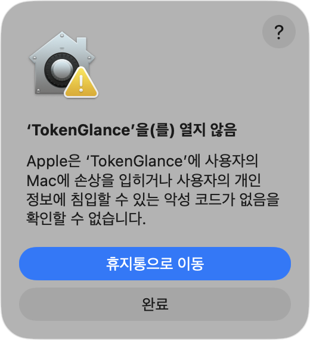
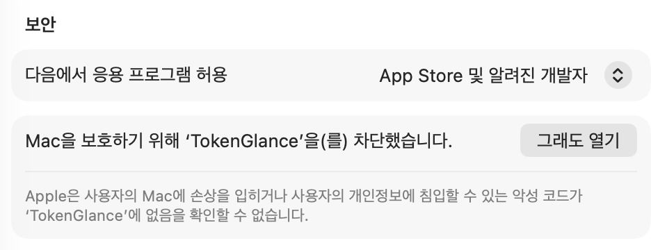
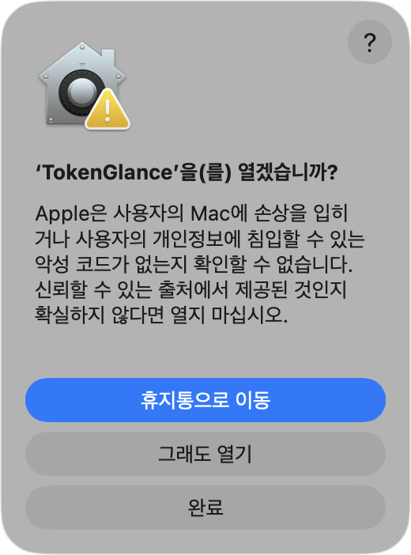
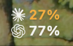
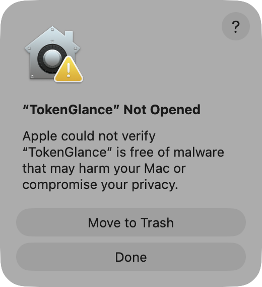
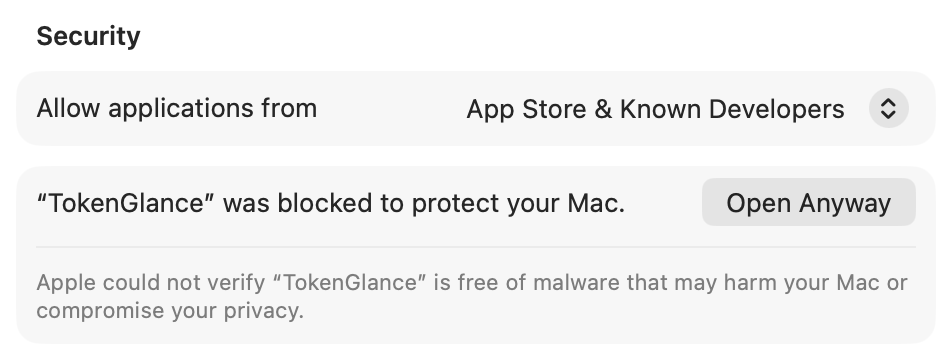
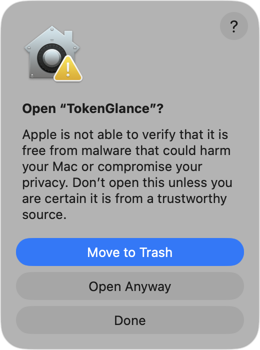

# Token Glance 설치 가이드 · Install guide

**[한국어](#한국어)** · **[English](#english)**

[README로 돌아가기 · Back to README](../README.md)

---

## 한국어

- [설치](#설치)
- [체크섬 확인](#체크섬-확인)
- [업데이트](#업데이트)
- [삭제](#삭제)
- [소스에서 빌드](#소스에서-빌드)
- [문제 해결](#문제-해결)

### 설치

요구 사항: Apple Silicon(arm64) Mac, macOS 14 이상, Claude Code 또는 Codex CLI.
릴리스 zip은 Apple Silicon 전용이고, ad-hoc 서명만 되어 있으며 Apple 공증(notarization)을 받지 않았습니다.
그래서 처음 열 때 macOS가 한 번 실행을 막습니다.

1. [Releases](https://github.com/yim0327/token-glance/releases/latest)의 최신 릴리스에서
   `TokenGlance-<버전>-macos-arm64.zip`을 내려받습니다. 같은 이름의 `.sha256` 파일도 함께 받아,
   압축을 풀기 전에 [체크섬을 확인](#체크섬-확인)하는 것을 권장합니다.
2. Finder에서 zip을 더블클릭해 압축을 풀고, `TokenGlance.app`을 Finder에서 **응용 프로그램** 폴더로
   끌어다 놓습니다.
3. 응용 프로그램 폴더에서 `TokenGlance.app`을 엽니다. **'TokenGlance'을(를) 열지 않음** 안내가 뜨면
   **완료**를 누릅니다. **휴지통으로 이동**은 누르지 않습니다.

   

4. **시스템 설정 › 개인정보 보호 및 보안**을 열고 아래로 스크롤해 **보안** 항목을 찾습니다.
   "Mac을 보호하기 위해 'TokenGlance'을(를) 차단했습니다." 옆의 **그래도 열기**를 누릅니다.

   

5. **'TokenGlance'을(를) 열겠습니까?** 확인 창에서 **그래도 열기**를 누릅니다. 암호나 Touch ID를
   요청하면 입력합니다.

   

6. 메뉴바에 두 줄 라벨이 나타나면 설치가 끝났습니다. Dock 아이콘은 없습니다. 다음 순서는 README의
   [처음 실행](../README.md#-처음-실행)입니다(Claude 한도 훅 설치).

   

위 화면은 macOS 26.6.2에서 찍었습니다. macOS 버전에 따라 문구와 화면 배치가 다를 수 있습니다.
**그래도 열기**는 이 저장소의 Releases에서 받았고 체크섬이 일치한 파일에만 사용하세요.

<details>
<summary>왜 차단되나요?</summary>

웹 브라우저로 내려받은 파일에는 macOS가 다운로드 표시(격리 속성)를 붙이고, 처음 열 때
Gatekeeper가 확인합니다. Token Glance는 Apple 공증을 받지 않았기 때문에 이 확인을 통과하지 못하고,
사용자가 시스템 설정에서 직접 허용해야 합니다. 허용은 그 앱에만 적용됩니다. 보안 설정 전체를 끄는
방법은 권하지 않습니다.

</details>

<details>
<summary>확인한 범위</summary>

- 릴리스 zip은 게시 전에 로컬에서 체크섬·서명·리소스·실행을 확인했습니다.
- v0.1.0은 게시 후 웹 브라우저로 내려받은 파일로 체크섬과 **그래도 열기** 흐름을 확인했습니다
  (macOS 26.6.2, Mac 한 대). 이 확인이 각 Mac에서 내려받은 파일이 거치는 Gatekeeper 확인을
  대신하지는 않습니다.
- v0.1.1은 게시 전 draft 릴리스에서 웹 브라우저로 내려받은 파일(게시된 첨부 파일과 같은 파일)로 설치,
  **그래도 열기** 흐름, 앱 아이콘을 확인했고, 게시 후에는 공개 주소에서 내려받은 파일의 체크섬을
  확인했습니다(같은 Mac). 알림 배너 아이콘에 관한 관찰은
  [v0.1.1 릴리스 노트](https://github.com/yim0327/token-glance/releases/tag/v0.1.1)에 있습니다.
- 이 문서의 스크린샷은 같은 Mac(macOS 26.6.2)에서, 이 저장소에서 빌드한 별도 사본에 다운로드 표시를
  붙여 찍었습니다. 앱 이름과 안내 문구는 릴리스 파일과 같습니다.
- 다른 macOS 버전과 Intel Mac에서는 확인하지 않았습니다.

</details>

<details>
<summary>터미널로 옮기면 안 되나요?</summary>

터미널의 `mv`로 응용 프로그램 폴더에 옮겼을 때는 앱이 App Translocation 경로(macOS가 정한 임시
위치)에서 실행되는 것이 관찰됐습니다. 그 앱을 지우고, zip을 다시 풀어 Finder에서 끌어다 놓았더니
`/Applications/TokenGlance.app`에서 실행됐습니다. "로그인 시 열기"는 앱 위치에 묶이므로 앱을 옮긴
뒤에 켭니다.

</details>

### 체크섬 확인

내려받은 zip이 릴리스에 올린 파일과 같은지 확인합니다. 압축을 풀거나 앱을 열기 전에 합니다. zip과 `.sha256` 파일이 있는 폴더(보통
다운로드 폴더)에서 터미널로 실행합니다. 파일 이름의 버전은 내려받은 버전으로 바꿉니다.

```sh
cd ~/Downloads
shasum -a 256 -c TokenGlance-0.1.1-macos-arm64.zip.sha256
```

`TokenGlance-0.1.1-macos-arm64.zip: OK`가 나오면 일치합니다.

`FAILED`가 나오거나 파일을 찾지 못하면 그 zip을 열지 말고 지운 뒤
[Releases](https://github.com/yim0327/token-glance/releases/latest)에서 zip과 `.sha256` 파일을 다시
내려받아 확인합니다. 두 파일이 같은 버전인지도 확인합니다.

### 업데이트

1. Token Glance를 종료합니다(상세 패널 › **종료**).
2. 새 버전을 내려받아 체크섬을 확인하고, Finder에서 **응용 프로그램** 폴더의 `TokenGlance.app`을 새
   앱으로 교체합니다.
3. 다시 엽니다. 다시 차단되면 [설치](#설치)의 3~5단계와 같이 허용합니다.

설정은 유지됩니다. 설정은 앱 식별자(`io.github.yim0327.token-glance`) 아래에 저장되며, 빌드
스크립트는 모든 릴리스에 같은 식별자를 씁니다. Claude 한도 훅도 계속 동작합니다. `settings.json`은
앱이 아니라 `~/Library/Application Support/TokenGlance/bin`에 설치된 훅 사본을 가리키기 때문입니다.
앱을 교체해도 이 사본은 갱신되지 않습니다.

### 삭제

1. Claude 한도 훅을 설치했다면 먼저 제거해 statusline을 되돌립니다. 메뉴바 항목 › **설정…** ›
   "Claude 한도 훅" › **제거**, 또는 터미널에서:

   ```sh
   ~/Library/Application\ Support/TokenGlance/bin/token-glance-hook uninstall
   ```

2. "로그인 시 Token Glance 열기"를 켰다면 설정에서 끕니다.
3. Token Glance를 종료하고, 응용 프로그램 폴더의 `TokenGlance.app`을 휴지통으로 옮깁니다.

앱을 지워도 남는 것:

| 내용 | 위치 |
|---|---|
| 앱 전용 데이터: 한도 캐시(`claude-rate-limits.json`). 훅을 제거하지 않았다면 훅 사본(`bin/`)과 기존 statusline 보관 파일(`statusline-backup.json`)도 | `~/Library/Application Support/TokenGlance` 폴더 |
| 앱 설정 | 앱 식별자 `io.github.yim0327.token-glance`의 사용자 설정 도메인. 파일은 `~/Library/Preferences/io.github.yim0327.token-glance.plist` |
| 훅 설치·복구·제거 때 만든 `settings.json` 백업 | `settings.json` 옆의 `settings.json.token-glance-backup-<시각>` (`~/.claude` 또는 `CLAUDE_CONFIG_DIR`) |

필요 없으면 위 항목만 직접 지웁니다. 다른 앱의 설정도 들어 있으므로 `~/Library/Preferences` 폴더
전체나 그 안의 다른 파일은 지우지 마세요. 훅을 제거하지 않은 채 `TokenGlance` 폴더를 지우면
`settings.json`이 없어진 훅을 가리키게 되므로, 먼저 1단계로 훅을 제거합니다. 각 백업은 그 작업 직전의
`settings.json` 전체이므로, 지우기 전에 지금의 `settings.json`이 원하는 상태인지 확인하세요.

### 소스에서 빌드

Swift 6 툴체인에서 빌드를 확인했습니다: CI는 Swift 6.1(Xcode 16.4), 개발 기기는 Swift 6.3(Command
Line Tools). `Package.swift`는 swift-tools-version 5.10을 선언하지만, Swift 5.10 툴체인으로는 확인하지
않았습니다. 테스트(`./scripts/test.sh`)는 Swift 6 툴체인에 들어 있는 swift-testing이 필요합니다.
직접 빌드한 앱은 이 Mac의 아키텍처로 만들어지고 ad-hoc 서명되며, 내려받은 파일이 아니므로 Gatekeeper
확인 없이 열립니다.

```sh
git clone https://github.com/yim0327/token-glance.git
cd token-glance
./scripts/bundle-app.sh
open dist/TokenGlance.app
```

### 문제 해결

설치와 실행에 관한 문제입니다. 사용 중 표시 문제(`--`, 훅, 온라인 조회)는 README의
[문제 해결](../README.md#-문제-해결)을 보세요.

| 증상 | 확인할 것 |
|---|---|
| 처음 열 때 "열지 않음" 안내 | 공증되지 않은 앱이라 정상입니다. [설치](#설치)의 3~5단계로 허용합니다. 보안 설정 전체를 끄는 방법은 권하지 않습니다. |
| 체크섬이 맞지 않음 | 그 파일을 열지 말고 [다시 내려받습니다](#체크섬-확인). |
| 로그인 시 열리지 않음 | "로그인 시 열기"는 앱 위치에 묶입니다. 앱을 옮겼다면 다시 켭니다. 시스템 설정 › 일반 › 로그인 항목에서 승인이 필요할 수 있습니다. |
| 터미널 `mv`로 옮긴 뒤 앱이 임시 위치에서 실행됨 | 앱을 지우고 zip을 다시 풀어 Finder에서 응용 프로그램 폴더로 끌어다 놓습니다([위 설명](#설치)). |

[맨 위로](#token-glance-설치-가이드--install-guide)

---

## English

- [Install](#install)
- [Check the checksum](#check-the-checksum)
- [Update](#update)
- [Uninstall](#uninstall)
- [Build from source](#build-from-source)
- [Troubleshooting](#troubleshooting)

### Install

Requirements: an Apple Silicon (arm64) Mac, macOS 14 or later, and Claude Code or Codex CLI.
The release zip is Apple Silicon only, ad hoc signed and not notarized by Apple, so macOS blocks the
first launch once.

1. From the latest release on the [Releases](https://github.com/yim0327/token-glance/releases/latest)
   page, download `TokenGlance-<version>-macos-arm64.zip`. Also download the `.sha256` file with the
   same name; checking the checksum before unzipping is recommended
   ([Check the checksum](#check-the-checksum)).
2. Unzip it by double-clicking the zip in Finder, then drag `TokenGlance.app` in Finder into the
   **Applications** folder.
3. Open `TokenGlance.app` from the Applications folder. When **"TokenGlance" Not Opened** appears,
   click **Done**. Do not click **Move to Trash**.

   

4. Open **System Settings › Privacy & Security** and scroll down to **Security**. Next to
   "“TokenGlance” was blocked to protect your Mac.", click **Open Anyway**.

   

5. In the **Open “TokenGlance”?** dialog, click **Open Anyway**. Enter your password or use Touch ID
   if asked.

   

6. When the two-line label appears in the menu bar, the install is done. There is no Dock icon.
   Next, follow [First run](../README.md#-first-run) in the README (installing the Claude limits
   hook).

   

These screens were captured on macOS 26.6.2. Wording and layout may differ on other macOS versions.
Use **Open Anyway** only for a file you downloaded from this repository's Releases and whose
checksum matched.

<details>
<summary>Why is it blocked?</summary>

macOS marks files downloaded with a web browser (the quarantine attribute), and Gatekeeper checks
them the first time they open. Token Glance is not notarized by Apple, so it does not pass that
check and you allow it yourself in System Settings. The approval applies to that app only. Turning
off security settings globally is not recommended.

</details>

<details>
<summary>What was checked</summary>

- The release zip was checked locally before publishing (checksum, signature, resources, launch).
- After v0.1.0 was published, a copy downloaded with a web browser was checked as well (checksum and
  the **Open Anyway** flow, macOS 26.6.2, one Mac). That does not replace the Gatekeeper check a
  downloaded file goes through on each Mac.
- v0.1.1 was installed from a copy downloaded with a web browser from the draft release (the same
  file as the published asset), and the **Open Anyway** flow and the app icon were checked with it.
  After publishing, the checksum of a copy downloaded from the public URL was checked (same Mac).
  What was seen in notification banners is in the
  [v0.1.1 release notes](https://github.com/yim0327/token-glance/releases/tag/v0.1.1).
- The screenshots in this guide were taken on the same Mac (macOS 26.6.2) with a separate copy built
  from this repository and marked as downloaded. The app name and the messages are the same as for
  the release file.
- Other macOS versions and Intel Macs have not been checked.

</details>

<details>
<summary>Can I move it with Terminal?</summary>

When the app was moved into Applications with `mv` in Terminal, it was observed running from an App
Translocation path (a temporary location chosen by macOS). After deleting it, unzipping again and
dragging it in Finder, it ran from `/Applications/TokenGlance.app`. "Open at login" is tied to the
app's location, so turn it on after moving the app.

</details>

### Check the checksum

This checks that the downloaded zip is the file uploaded to the release. Do it before unzipping or
opening the app. Run it in Terminal in the
folder with the zip and the `.sha256` file (usually Downloads). Replace the version in the file name
with the one you downloaded.

```sh
cd ~/Downloads
shasum -a 256 -c TokenGlance-0.1.1-macos-arm64.zip.sha256
```

`TokenGlance-0.1.1-macos-arm64.zip: OK` means it matches.

If it says `FAILED` or cannot find the file, do not open that zip. Delete it, download the zip and
the `.sha256` file again from [Releases](https://github.com/yim0327/token-glance/releases/latest) and
check again. Make sure both files are for the same version.

### Update

1. Quit Token Glance (details panel › **Quit**).
2. Download the new version, check its checksum, and in Finder replace `TokenGlance.app` in
   **Applications** with the new one.
3. Open it again. If it is blocked again, allow it as in steps 3–5 of [Install](#install).

Settings are kept: they are stored under the app identifier (`io.github.yim0327.token-glance`), which
the build script sets to the same value for every release. The Claude limits hook keeps working,
because `settings.json` points to its installed copy in
`~/Library/Application Support/TokenGlance/bin`, not to the app. Replacing the app does not update
that copy.

### Uninstall

1. If you installed the Claude limits hook, uninstall it first to restore your statusline: menu bar
   item › **Settings…** › "Claude limits hook" › **Uninstall**, or in Terminal:

   ```sh
   ~/Library/Application\ Support/TokenGlance/bin/token-glance-hook uninstall
   ```

2. If you turned on "Open Token Glance at login", turn it off in Settings.
3. Quit Token Glance and move `TokenGlance.app` from Applications to the Trash.

What stays after deleting the app:

| What | Where |
|---|---|
| App data: the limit cache (`claude-rate-limits.json`); if the hook was not uninstalled, also the hook copy (`bin/`) and the saved previous statusline (`statusline-backup.json`) | the `~/Library/Application Support/TokenGlance` folder |
| App settings | the user defaults domain of the app identifier `io.github.yim0327.token-glance`; the file is `~/Library/Preferences/io.github.yim0327.token-glance.plist` |
| `settings.json` backups made when installing, repairing or uninstalling the hook | `settings.json.token-glance-backup-<time>` next to `settings.json` (`~/.claude` or `CLAUDE_CONFIG_DIR`) |

Delete only these items yourself if you no longer need them. Do not delete the
`~/Library/Preferences` folder or other files in it; they hold other apps' settings. Deleting the
`TokenGlance` folder while the hook is still installed leaves `settings.json` pointing to a missing
hook, so uninstall the hook first (step 1). Each backup is the whole `settings.json` from just before
that change, so check that your current `settings.json` is what you want before deleting it.

### Build from source

Builds were checked with Swift 6 toolchains: Swift 6.1 (Xcode 16.4) on CI and Swift 6.3 (Command Line
Tools) on the development Mac. `Package.swift` declares swift-tools-version 5.10, but a Swift 5.10
toolchain has not been tried. The tests (`./scripts/test.sh`) need swift-testing, which ships with
Swift 6 toolchains. A locally built app is built for this Mac's architecture and ad hoc signed; it was
not downloaded, so it opens without a Gatekeeper check.

```sh
git clone https://github.com/yim0327/token-glance.git
cd token-glance
./scripts/bundle-app.sh
open dist/TokenGlance.app
```

### Troubleshooting

Problems with installing and opening the app. For problems while using it (`--`, the hook, online
checks), see [Troubleshooting](../README.md#-troubleshooting) in the README.

| Symptom | What to check |
|---|---|
| "Not Opened" the first time you open it | Expected for an app that is not notarized. Allow it with steps 3–5 of [Install](#install). Turning off security settings globally is not recommended. |
| The checksum does not match | Do not open that file; [download it again](#check-the-checksum). |
| Does not open at login | "Open at login" is tied to the app's location; turn it on again after moving the app. macOS may ask for approval in System Settings › General › Login Items. |
| After moving it with `mv` in Terminal, the app runs from a temporary location | Delete the app, unzip again and drag it into Applications in Finder ([see above](#install)). |

[Back to top](#token-glance-설치-가이드--install-guide)
